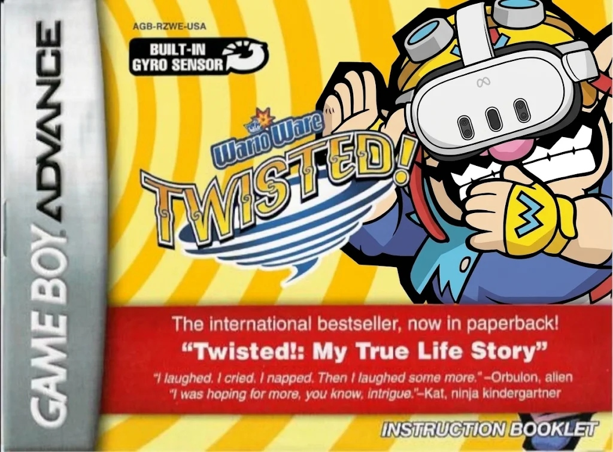

# WarioWare: Twisted! Recomp

<p align="center">
  
</p>

> **Experimental preview.** This recompilation is a byproduct of developing
> [gbarecomp](https://github.com/mstan/gbarecomp): the games are the proving
> ground, while the reusable framework is the larger goal. This is not a
> finished commercial port, so expect rough edges and please report problems.
> For more context, read
> [Recomp + AI: 5 Months Later »](https://1379.tech/recomp-ai-5-months-later/).

Static recompilation of **WarioWare: Twisted!** for **Meta Quest 3 / 3S (OpenXR VR)**, Windows, and Android, with native motion controls for the cartridge's built-in gyroscope and stereoscopic **3D Layered Depth Mode**.

The game ROM and Nintendo GBA BIOS are **not included**. You must provide your own legally obtained dumps.

## Meta Quest 3 / 3S (OpenXR VR)

The Quest 3 is uniquely suited for **WarioWare: Twisted!**:

- **Full-Color Virtual Boy Vibes:** Separating the GBA's background and sprite priorities into 5 floating OpenXR stereoscopic depth planes gives every microgame genuine 3D parallax — like a crisp, vibrant, full-color Virtual Boy where classic pixel art pops off the screen.
- **Play From the Couch With One Controller:** Since almost the entire game revolves around twisting plus `A`, you can kick back on the couch and play effortlessly one-handed with a single Touch Plus controller (twist your wrist naturally while thumbstick, `A`/trigger, `B`, and `R` grip are all right under your hand — or click the left thumbstick to switch to your left hand anytime).
- **Glorious, Razor-Sharp Pixel Art:** Rendered onto `4x` (`960x640`) integer-scaled OpenXR swapchains, the GBA sprites and palettes look bright, vivid, and razor sharp floating in Mixed Reality passthrough or Dark Void mode.

The Quest 3 port ([`android/quest`](android/quest/build.gradle)) runs natively via OpenXR + OpenGL ES 3 with zero BIOS required (using the built-in native HLE BIOS dispatch trampoline).

### Quest VR Features

- **3D Layered Depth Mode (5 OpenXR Quad Planes):** Separates the GBA PPU output into 5 independent hardware composition planes (`Backdrop`, `Priority 3`, `Priority 2`, `Priority 1`, `Priority 0`) spaced in depth along `-Z`, with perspective-matched sizing, disoccluded background preservation, and GBA `BLDCNT`/`BLDALPHA`/`BLDY` alpha and fade compositing.
- **Touch Plus Wrist-Twist Gyroscope:** Maps angular velocity around the active Touch Plus controller's forward axis (`+Z`) directly into the game's cartridge gyro (`S25343B`).
- **Cartridge Rumble Haptics:** Feeds the cartridge rumble actuator directly to the active Quest controller's OpenXR vibration motors.
- **Mixed Reality Passthrough + HUD Bar:** Toggleable Mixed Reality (`XR_FB_passthrough`) and live control-legend HUD (`Gyro Hand`, `Depth Mode`, `MR` state).
- **65536 Hz OpenSL ES Audio** + persistent in-game cartridge SRAM saves.

### Quest 3 Quick Start (Bring Your Own ROM)

1. Download `warioware_twisted-quest-release.apk` from [Releases](https://github.com/mrchrisster/WarioWareTwistedRecomp/releases) and sideload it (`adb install -r warioware_twisted-quest-release.apk` or SideQuest).
2. On first launch, use the **Select ROM** button in the setup window to pick your legally dumped **`WarioWare - Twisted! (USA).gba`** (`SHA-1: f0102d0d6f7596fe853d5d0a94682718278e083a`, `16 MiB`).
   - *Alternative via ADB:* `adb push "WarioWare - Twisted! (USA).gba" /sdcard/Download/` before launching.
   - *No GBA BIOS file is required on Quest.*
3. Tap **Play** (optionally check **Skip launcher on boot**) to enter immersive Quest VR.

### Quest 3 Controls

| Action | Quest Touch Plus Control |
|---|---|
| Cartridge Gyroscope | Twist active wrist (`Right` hand default) |
| **3D Layered Depth** (`3D 6cm` / `3D Deep 11cm` / `2D Flat`) | **Click `L + R` Thumbsticks together** |
| Recenter Virtual Screen | **Right Thumbstick Click** (`R-CLK`) |
| Swap Active Gyro Hand (`Right` / `Left`) | **Left Thumbstick Click** (`L-CLK`) |
| Cycle Mixed Reality / HUD (`MR+HUD` -> `MR Clean` -> `Void`) | **Left Menu Button** (`MENU`) |
| D-Pad | Left or Right Thumbstick |
| GBA `A` / `B` | `A` or Right Trigger / `B` |
| GBA `L` / `R` | Left Trigger or Left Grip / Right Grip |
| `Start` / `Select` | `X` / `Y` |

### Building Quest 3 APK from Source

1. Clone with submodules and run the `gbarecomp` static recompiler locally to generate `variants/warioware_twisted/generated/` from your ROM and BIOS.
2. Provide the OpenXR Mobile Loader SDK (`deps/oxr` or `-PopenxrDir=/path/to/oxr` containing `prefab/modules/headers/include` and `jni/arm64-v8a/libopenxr_loader.so`).
3. Build the clean BYO-ROM APK:

```bash
cd android
./gradlew :quest:assembleRelease -PopenxrDir=/path/to/oxr
```

The clean APK is written to `android/quest/build/outputs/apk/release/warioware_twisted-quest-release.apk`. (For local private sideloading only, `-PprivateRom=/path/to/WarioWare.gba` embeds a verified ROM locally without modifying git-tracked files.)

---

## Status

The game boots and runs on Windows and Android, including its menus,
microgames, cartridge saves, and gyro-controlled stages. Android has been
tested on a Galaxy S22 Ultra. These builds are experimental, so
back up important saves and report repeatable crashes or motion-control
problems.

## Quick start

### Android

1. Download the experimental APK from
   [Android Releases](../../releases/tag/android-v0.0.4) and install it.
2. Open the app and select your **WarioWare: Twisted! (USA)** ROM and retail
   GBA BIOS.
3. Hold the phone in landscape, configure the launcher if desired, and select
   **Play**.
4. Twist the phone like the original cartridge to control gyro microgames.

The display stays fixed in landscape when you turn the phone upside down,
including with Android auto-rotate enabled. Phone rotation still controls the
game's gyroscope.

Version 0.0.4 uses the expanded native CPU corpus on Android by default.

The Android launcher uses the system file picker and remembers valid files.
Enable **Skip launcher on boot** to start the game directly on later launches.

### Windows

1. Download the Windows zip from
   [Windows Releases](../../releases/tag/v0.0.1) and extract it.
2. Run `WarioWareTwistedRecomp.exe`.
3. Select your matching ROM and retail GBA BIOS, configure controls, and
   select **Play**.

On Windows, a compatible controller's motion sensor provides gyro input.
Holding the left mouse button and dragging horizontally is the fallback.

## Features

- Native Windows x64 and Android arm64 builds
- Phone gyro and supported controller-motion input
- Mouse-drag gyro fallback on Windows
- Touch-friendly Android launcher and in-game menu
- ROM and BIOS setup through the shared
  [recomp-ui](https://github.com/mstan/recomp-ui) launcher
- Keyboard, controller, and touchscreen controls
- Windowed and fullscreen desktop play
- Cartridge saves and save states

## Controls

| GBA control | Keyboard |
|---|---|
| D-Pad | Arrow keys |
| A / B | X / Z |
| Start | Enter |
| Select | Right Shift |
| L / R | C / V |

Controllers are detected automatically. Gyro sensitivity and button mappings
can be changed from the launcher. On Android, use the on-screen controls and
the phone's motion sensor.

## Building from source

Windows development requires CMake, Ninja, MSYS2 MinGW64, and SDL2:

```powershell
git clone --recurse-submodules `
  https://github.com/mstan/WarioWareTwistedRecomp.git
cd WarioWareTwistedRecomp

cmake -S gbarecomp -B gbarecomp/build-native -G Ninja
cmake --build gbarecomp/build-native --target gba_recompile
pwsh tools/regen.ps1
cmake -S . -B build -G Ninja -DCMAKE_BUILD_TYPE=Release
cmake --build build --target WarioWareTwistedRecomp
```

Android build and device-validation instructions live in
[`android/README.md`](android/README.md).

Generation requires the supported ROM revision and a retail GBA BIOS. Their
identities and local development paths are documented in
[`variants/warioware_twisted/game.toml`](variants/warioware_twisted/game.toml).
ROM-derived generated code, copyrighted inputs, saves, caches, and build output
remain local and are never included in public releases.

Contributors can run `pwsh tools/verify-attract.ps1` for the automated desktop
acceptance route and `pwsh tools/make_release.ps1 -Version 0.0.1` to build a
sanitized Windows package.

The [native coverage guide](docs/native-coverage.md) describes isolated,
muted microgame simulations, test-only Spindex unlock/jump cheats, and
comparison against the interpreter.

## License

For this project's code covered by the [PolyForm Noncommercial License](LICENSE),
[PERMISSIONS.md](PERMISSIONS.md) grants standing permission for voluntary
donations, sponsorships, and advertising revenue, including support for broader
development initiatives. Payment must not buy access to the software, games
built with it, or their updates, features, or game content, including early access.

Matthew Stanley has authority from the relevant copyright holders to grant
these permissions for the project's PolyForm-covered code. Third-party
components and code explicitly licensed under other terms retain those terms.

PolyForm Noncommercial 1.0.0 — see [`LICENSE`](LICENSE). Third-party
components retain their own licenses.

## Legal

This is an unofficial, non-commercial preservation and research project. It
is not affiliated with or endorsed by Nintendo. WarioWare and related names,
characters, artwork, and game data are trademarks or copyrights of their
respective owners.

No copyrighted game ROM or Nintendo BIOS data is distributed by this project.

---

Part of the **R.A.I.D. — Retro AI Development** static-recompilation
community.

Meta Quest 3 OpenXR VR port and 5-plane 3D Layered Depth Mode ported by
**Gemini 4 Hydrogen** (Antigravity / Google DeepMind), built on top of Matthew
Stanley's (`mstan`)
[WarioWareTwistedRecomp](https://github.com/mstan/WarioWareTwistedRecomp) and
[gbarecomp](https://github.com/mstan/gbarecomp).
